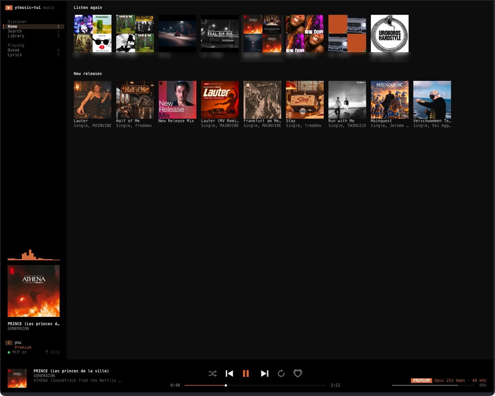
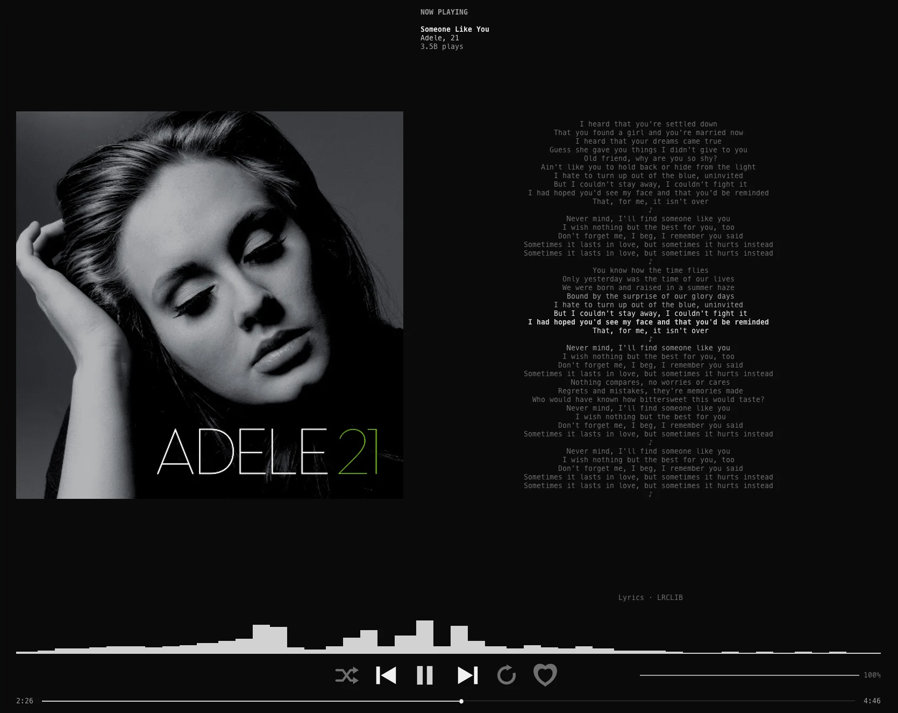

<div align="center">

# ytmusic-tui

**YouTube Music in your terminal.**

A fast, good-looking music player written in Rust,<br>
with synced lyrics, album-art colors and a live visualizer.

[](https://github.com/everything-tui/ytmusic-tui/releases/latest)
[](#install)
[](https://github.com/everything-tui/ytmusic-tui/releases/latest)
[](LICENSE)

<a href="docs/screenshots/home.png"></a>
<a href="docs/screenshots/now-playing.png"></a>

<sub><b>Home</b>: personal feed, library and player &nbsp;·&nbsp; <b>Now Playing</b>: full-screen cover, synced lyrics, visualizer</sub>

**[Install](#install)** · **[Quick start](#quick-start)** · **[Sign in](#signing-in)** · **[Keys](#keyboard)** · **[Config](#config)** · **[MCP](#control-from-claude-mcp)**

</div>

## Why ytmusic-tui

| | |
|---|---|
| 🎵 **Play anything** | Search songs, albums, artists and playlists. Queue, shuffle, repeat, radio autoplay. |
| 📚 **Your library** | Liked songs, playlists, albums, artists and history once you sign in. |
| 🎤 **Synced lyrics** | Line-by-line lyrics from [LRCLIB](https://lrclib.net), with YouTube Music as fallback. |
| 🎨 **Looks the part** | Accent color taken from the album art, spectrum visualizer, 9 themes. |
| 🎛️ **Equalizer** | 5-band EQ with presets such as Bass Boost. |
| 🖥️ **Feels native** | macOS media keys and Control Center, session restore, mouse support. |
| ⚡ **Nothing extra** | No API key, no `yt-dlp`, no Node. One binary. |

## Install

**Homebrew** (macOS / Linux):

```bash
brew install everything-tui/tap/ytmusic-tui
```

Update later with `brew upgrade ytmusic-tui`.

<details>
<summary><b>Installer script</b> (Linux, macOS, Windows)</summary>

&nbsp;

Linux / macOS:

```bash
curl --proto '=https' --tlsv1.2 -LsSf https://github.com/everything-tui/ytmusic-tui/releases/latest/download/ytmusic-tui-installer.sh | sh
```

Windows (PowerShell):

```powershell
powershell -ExecutionPolicy Bypass -c "irm https://github.com/everything-tui/ytmusic-tui/releases/latest/download/ytmusic-tui-installer.ps1 | iex"
```

The installers place the `ytmusic-tui` binary on your `PATH` (under `CARGO_HOME` by default).

</details>

<details>
<summary><b>Prebuilt binaries</b></summary>

&nbsp;

Every [GitHub Release](https://github.com/everything-tui/ytmusic-tui/releases) has these archives, each with a `.sha256` checksum:

| Platform | Archive |
|---|---|
| macOS, Apple Silicon | `ytmusic-tui-aarch64-apple-darwin.tar.xz` |
| macOS, Intel | `ytmusic-tui-x86_64-apple-darwin.tar.xz` |
| Linux x86_64 (glibc) | `ytmusic-tui-x86_64-unknown-linux-gnu.tar.xz` |
| Linux arm64 (glibc) | `ytmusic-tui-aarch64-unknown-linux-gnu.tar.xz` |
| Windows x86_64 | `ytmusic-tui-x86_64-pc-windows-msvc.zip` |
| Windows ARM64 | `ytmusic-tui-aarch64-pc-windows-msvc.zip` |

On Linux the binaries need ALSA (`libasound2`) and D-Bus (`libdbus-1-3`) at runtime. Nearly every desktop distribution has both.

</details>

<details>
<summary><b>Build from source</b></summary>

&nbsp;

Install the stable Rust toolchain from [rustup](https://rustup.rs) and the platform prerequisites:

| Platform | Prerequisites |
|---|---|
| macOS | `xcode-select --install` |
| Debian / Ubuntu | `sudo apt install build-essential pkg-config libasound2-dev libdbus-1-dev` |
| Fedora | `sudo dnf install gcc pkgconf-pkg-config alsa-lib-devel dbus-devel` |
| Arch | `sudo pacman -S base-devel alsa-lib dbus` |
| Windows | [Visual Studio Build Tools](https://visualstudio.microsoft.com/visual-cpp-build-tools/) with "Desktop development with C++" |

Then, from the repository root:

```bash
cargo install --path . --locked
```

That puts `ytmusic-tui` in `~/.cargo/bin`. For just the binary in `target/release/`, run `cargo build --release`.

</details>

## Quick start

```bash
ytmusic-tui
```

1. Press <kbd>Enter</kbd> to sign in (see [Signing in](#signing-in)), or <kbd>G</kbd> to listen as a guest.
2. Press <kbd>/</kbd> to search, then <kbd>Enter</kbd> to play.
3. Press <kbd>?</kbd> any time for the full keyboard reference.

## Signing in

ytmusic-tui signs in with the session cookies of a logged-in YouTube Music page. You hand them over **once** by pasting a request copied as cURL from your browser's DevTools. The sign-in window in the app shows the same steps.

> [!IMPORTANT]
> **Copy the cURL from a fresh private / incognito window, never from your normal YouTube Music tab.**
>
> The cookies are a live session. Every browser tab that uses that session keeps refreshing (rotating) them in the background. If you copy them from your everyday tab, that tab rotates them again shortly afterwards and the copy inside ytmusic-tui stops working, usually within minutes to hours. You then look "signed out" in the app.
>
> A session started in a private window and closed right after the paste is used by nobody except ytmusic-tui. The app then refreshes the cookies itself and stays signed in.

1. Open a **private / incognito window**:

   | Browser | macOS | Windows / Linux |
   |---|---|---|
   | Chrome, Edge, Brave | <kbd>Cmd</kbd> <kbd>Shift</kbd> <kbd>N</kbd> | <kbd>Ctrl</kbd> <kbd>Shift</kbd> <kbd>N</kbd> |
   | Firefox | <kbd>Cmd</kbd> <kbd>Shift</kbd> <kbd>P</kbd> | <kbd>Ctrl</kbd> <kbd>Shift</kbd> <kbd>P</kbd> |
   | Safari | <kbd>Cmd</kbd> <kbd>Shift</kbd> <kbd>N</kbd> | |

2. Go to [music.youtube.com](https://music.youtube.com) and sign in with your Google account.
3. Open DevTools (<kbd>F12</kbd>, or <kbd>Cmd</kbd> <kbd>Option</kbd> <kbd>I</kbd> on macOS) and switch to the **Network** tab.
4. Reload the page. Type `browse` in the filter box and pick any request to `music.youtube.com`.
5. Right-click the request → **Copy** → **Copy as cURL**.
   - Chrome / Edge: "Copy as cURL (bash)"
   - Firefox: "Copy as cURL (POSIX)"
   - Safari: enable the Develop menu first (Settings → Advanced → "Show features for web developers")
6. In ytmusic-tui press <kbd>L</kbd> (or <kbd>P</kbd>), paste, and press <kbd>Enter</kbd>.
7. **Close the private window. Do not sign out there.** Signing out ends the session you just gave to ytmusic-tui.

Signed out later? Repeat these steps with a new private window.

> [!NOTE]
> After sign-in, ytmusic-tui owns that session and rotates the cookies in the background like a browser tab would. No browser access or Full Disk Access is needed. The session is stored in a `0600` file (`auth.json`) in the app data directory; the OS keychain is not used, so there are no password prompts.

**Guest mode** (<kbd>G</kbd> on the welcome screen) lets you search and play without an account, but without library or likes.

## Keyboard

| Key | Action |
|---|---|
| <kbd>Space</kbd> | Play / pause |
| <kbd>n</kbd> / <kbd>p</kbd> | Next / previous track |
| <kbd>/</kbd> | Search |
| <kbd>1</kbd> … <kbd>5</kbd> | Home · Search · Library · Queue · Lyrics |
| <kbd>Tab</kbd> / <kbd>f</kbd> | Full-screen Now Playing |
| <kbd>←</kbd> / <kbd>→</kbd> | Move between Home shelves / Library sections (seek ±5 s elsewhere) |
| <kbd>,</kbd> / <kbd>.</kbd> | Seek ±5 s (<kbd>Shift</kbd> <kbd>←</kbd> / <kbd>→</kbd>: ±30 s) |
| <kbd>e</kbd> | Equalizer |
| <kbd>L</kbd> | Account / sign in |
| <kbd>Ctrl</kbd> <kbd>P</kbd> | Command palette |
| <kbd>?</kbd> | All keys |
| <kbd>q</kbd> | Quit |

Command-line helpers:

```bash
ytmusic-tui login     # explains how to sign in
ytmusic-tui logout
ytmusic-tui doctor    # environment diagnostics
ytmusic-tui --debug   # verbose file logging
```

## Config

Switch themes live from the command palette (<kbd>Ctrl</kbd> <kbd>P</kbd>, type "theme"); the choice is saved for you. Everything else lives in `config.toml`, written on first run:

| OS | Path |
|---|---|
| macOS | `~/Library/Application Support/com.ytmusic-tui.ytmusic-tui/config.toml` |
| Linux | `~/.config/ytmusic-tui/config.toml` |

<details>
<summary><b>All options</b></summary>

&nbsp;

```toml
[ui]
theme = "midnight"         # midnight | oled | catppuccin | tokyo-night | nord | gruvbox | rose-pine | dracula | light
accent = ""                # "#rrggbb" to override the theme's accent
dynamic_accent = true      # tint the accent with the playing track's cover art
icons = "text"             # "nerd" for Nerd Font icons in the sidebar and lists
visualizer = "bars"        # bars | mirror | wave | off
show_hints = true

[ui.colors]                # optional per-color overrides on top of the theme
# bg = "#101014"
# bg_sidebar = "#0a0a0d"   # also: bg_player bg_hover bg_selected bg_modal
# text = "#ececf1"         # also: dim muted faint border error success

[playback]
autoplay = true
volume = 0.8
cache_size_mb = 1024
prefetch = true
prewarm = true             # fetch the start of highlighted/upcoming tracks so they play instantly
eq_enabled = true
eq_gains = [0.0, 0.0, 0.0, 0.0, 0.0]  # Bass … Treble, ±12 dB

[control]
enabled = false            # MCP control bridge, see below
```

Logs go to `…/Caches/…/logs/ytmusic-tui.log`, never to the terminal.

</details>

> [!TIP]
> Use a terminal with **truecolor** and a graphics protocol (Ghostty, Kitty, iTerm2, WezTerm) for sharp album art. Inside **tmux**, art may fall back to half-block characters unless passthrough is configured. Comfortable minimum size is **80×24**; below that the sidebar shrinks to an icon rail.

## Control from Claude (MCP)

ytmusic-tui can be driven by an MCP client such as Claude Code. It is off by default.

1. Enable it in `config.toml`:

   ```toml
   [control]
   enabled = true
   ```

2. Start ytmusic-tui as usual, then register the bridge (on Windows: `ytmusic-tui.exe mcp`):

   ```bash
   claude mcp add ytmusic-tui -- ytmusic-tui mcp
   ```

Tools cover playback, volume, shuffle/repeat, search and queue management. Account cookies and sign-in are never exposed, and searches run as a guest.

<details>
<summary>How it stays private</summary>

&nbsp;

The TUI listens on `127.0.0.1` on a random port. The port and a random per-launch token are written to `control.json` in the data directory (readable only by you on Unix). Clients must present the token, so other local processes can't drive playback.

</details>

## How playback works

Stream URLs are resolved natively through YouTube's Innertube API, so no `yt-dlp`, Node, Deno or Bun is needed. When signed in, tracks the default clients refuse (Music Premium only, age-restricted) fall back to the YouTube Music web client; its ciphered URLs are solved with [yt-dlp's EJS solver](https://github.com/yt-dlp/ejs) running on an embedded QuickJS.

> [!WARNING]
> **Known limitations**
> - Premium-only tracks need a signed-in Music Premium account.
> - Age-restricted tracks need a signed-in, age-verified account. Without Premium, YouTube may also demand a PO token, which isn't supported.
> - Region-locked tracks may not play.
> - If YouTube changes its player clients, the resolver may need updated client constants.

## Contributing

```bash
cargo build
cargo test
cargo run -- doctor
```

The app is Elm-style: one `App` state plus async services for the API, player, art, lyrics and auth.

<details>
<summary><b>Releasing</b></summary>

&nbsp;

The version lives in three places that must match: the top `## [X.Y.Z] - YYYY-MM-DD` entry in [`CHANGELOG.md`](CHANGELOG.md), `version` in `Cargo.toml`, and `Cargo.lock`. Check with `scripts/version.sh check` (CI runs it on every PR).

To release, open a PR from `main` into `publish` and merge it. CI builds every platform with [cargo-dist](https://opensource.axo.dev/cargo-dist/), creates tag `vX.Y.Z` and the GitHub Release (notes come from `CHANGELOG.md`), and updates the Homebrew formula in `everything-tui/homebrew-tap`.

</details>

<details>
<summary><b>Manual QA checklist</b></summary>

&nbsp;

- [ ] Cold play works with no yt-dlp / node / deno installed
- [ ] Guest mode: search + play
- [ ] Incognito cURL paste sign-in (Chrome, Firefox, Safari)
- [ ] Library + like after sign-in
- [ ] Seek, skip, shuffle, repeat, queue reorder
- [ ] Session restore (paused at last position)
- [ ] Lyrics panel with synced highlight
- [ ] Visualizer responds while playing
- [ ] Media keys / Now Playing on macOS
- [ ] Resize down to 80×24; Kitty / iTerm / Terminal.app
- [ ] `ytmusic-tui doctor` prints sensible diagnostics

</details>

## Disclaimer

This project is **not** affiliated with, endorsed by, or supported by Google or YouTube. Use at your own risk and respect YouTube's Terms of Service.

## License

[MIT](LICENSE)
